  

#### Backend Developer | PHP & Laravel

#### Electronics & Communication Engineering Student

#### Building scalable web applications and continuously improving my software engineering skills.

---
## 👨‍💻 About Me

* 🎓 Electronics & Communication Engineering Student.
* 💻 Backend Developer specializing in PHP & Laravel.
* 🌱 Currently learning Advanced Laravel and Software Architecture.
* 🚀 Passionate about building scalable web applications.
* 📚 Always learning and improving.

---

## 🛠 Tech Stack

---

## 🌱 Current Focus

* Advanced Laravel
* REST APIs
* Authentication & Authorization
* Design Patterns
* Software Architecture
* Linux

---

## 🎯 2026 Goals

* Master Laravel
* Learn Linux
* Build Production-ready Applications
* Improve Software Architecture Skills
* Contribute to Open Source

---

## 📊 GitHub Stats

---

## 🔥 GitHub Streak

---

## 📈 Contribution Graph

---

## 📑 Profile Summary

---

## 🚀 Featured Projects

### 💬 Vexo — RESTful Messaging API

A RESTful messaging API built with Laravel, featuring secure authentication, conversation management, and participant-based access control.

**Key Features**
- Phone number-based registration and authentication.
- Laravel Sanctum token authentication.
- Conversation and message management.
- Authorization using Laravel Policies.
- Automated testing with Pest.

**Built With**

**Status:** In Development

🔗 [GitHub Repository](https://github.com/mohamedragabdev/vexo)

---

### 🏥 Shifago — Medical Home Services

A healthcare platform designed to connect patients with medical home services, providing a convenient way to access healthcare solutions.

**Built With**

---

### 🧠 GlucoRAG — Medical Retrieval-Augmented Generation

A medical RAG system designed to retrieve relevant information from medical documents and generate context-aware responses using AI.

**Built With**

**Technologies**
- FastAPI
- LangChain
- Supabase
- PostgreSQL & pgvector
- OpenAI Embeddings

---

### 🧭 ADHD Compass

A project focused on supporting individuals with ADHD through technology-driven solutions.

**Built With**

---

🚀 More projects are coming soon...

---

## 📫 Connect With Me

---

## 💭 Philosophy

> Continuous improvement beats perfection.

---

## 🐍 Contribution Snake

---

⭐ Always learning, building, and improving.

